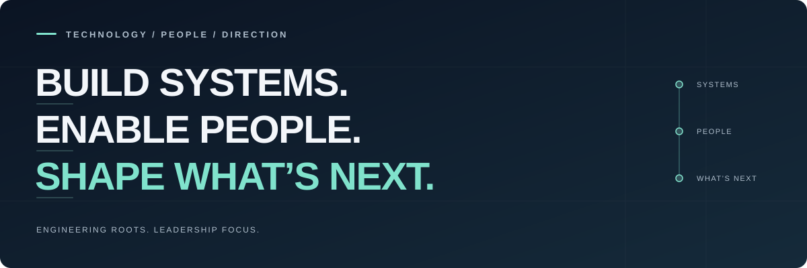

I'm a technology leader who still enjoys getting his hands dirty with code. I believe good governance should enable bold decisions, not prevent them, and that what we build today should still be maintainable by whoever inherits it five years from now.

The rest? Mostly **chainsaw juggling**: balancing ambition, risk and engineering discipline with enough pragmatism to deliver.

<!-- Maintenance notes (not displayed on your profile):
Add a Find me line when your verified LinkedIn or personal site URLs are ready.
Every three months, check that the positioning is current and any public links work.
Keep sensitive projects out; public project examples are optional.
-->
